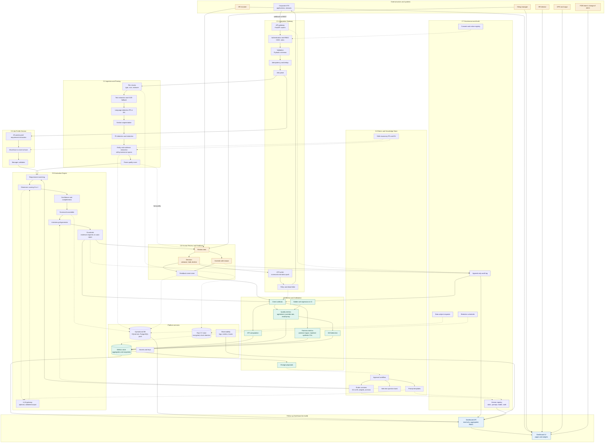
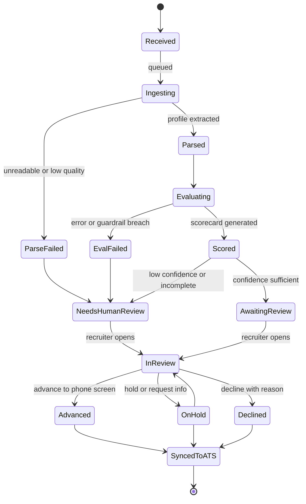
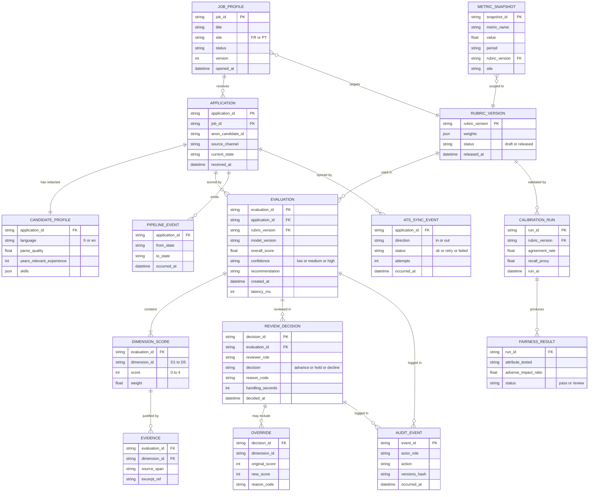
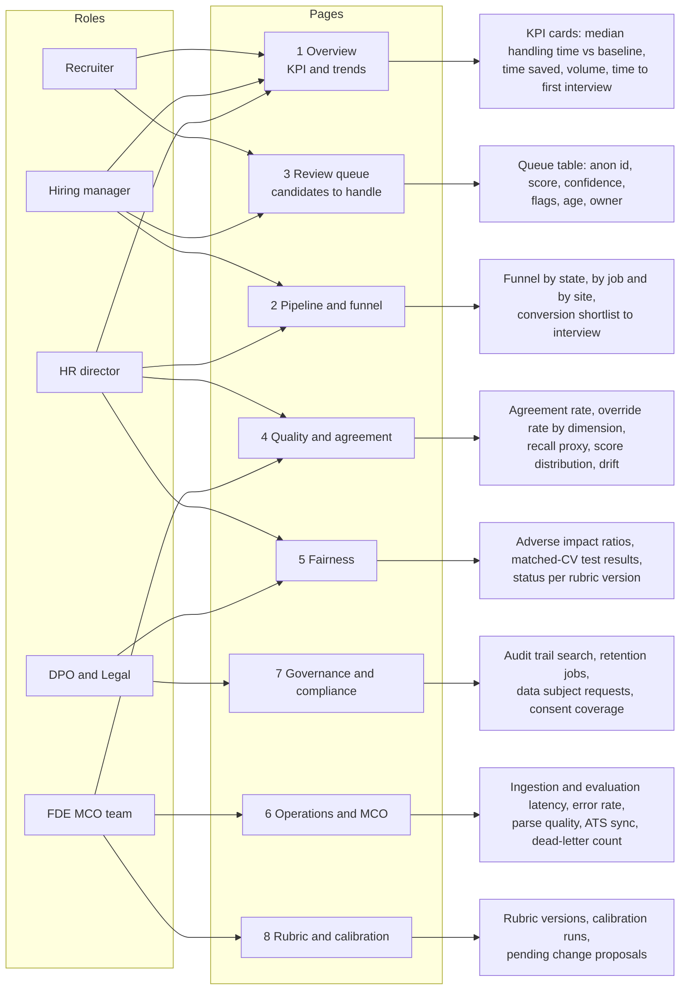

# ATS Copilot: Architecture Brief for the Follow-Up Dashboard

> **How to use this file with another LLM.** Paste the whole file. Ask the LLM to build the dashboard described in section 5, using the diagrams as the source of truth for components, data and flows. Sections 1 to 4 are the system; section 5 is the dashboard.

## 0. Context for the LLM

- **System:** an internal AI copilot that helps HR recruiters pre-screen candidates for Forward Deployed Engineer (FDE) roles at ALTEN (France and Porto). It parses CVs, scores them against a versioned rubric with evidence, and produces a scorecard. **A human recruiter always decides.**
- **Dashboard purpose:** follow up (suivi) the recruitment pipeline, the value delivered (time saved), the quality and fairness of the scoring, the operational health of the system, and compliance.
- **Primary KPI:** reduce initial technical pre-screening time per candidate by 50 % (median active handling time).
- **Hard constraints:** no raw CV or protected attribute is ever shown; candidates appear only under an anonymized id; every metric is traceable to rubric, model and code versions.
- **Language:** UI in French with English labels available; code and API in English.

---

## 1. Master Architecture (Components, Stores, Flows)

### Reading guide

| Flow | Meaning |
|---|---|
| Solid arrows | Main synchronous or sequential flow |
| Dashed arrows | Asynchronous, optional, governance or storage flows |
| Orange | Human actors and steps |
| Purple | Governance and compliance |
| Green | Metrics and calibration |
| Blue | The dashboard to build |

---

## 2. Candidate Pipeline State Machine

The dashboard funnel and queue views are driven by these states.

---

## 3. Data Model Feeding the Dashboard

---

## 4. Event Catalog (What the Dashboard Can Rely On)

| Event | Emitted by | Key fields | Used for |
|---|---|---|---|
| `application.received` | C1 | application_id, job_id, source_channel | Volume, funnel start |
| `parse.completed` / `parse.failed` | C2 | parse_quality, language | Parsing health |
| `evaluation.completed` | C5 | overall_score, confidence, latency_ms, versions | Scoring distribution |
| `guardrail.breached` | C5 | rule, evaluation_id | Quality and safety alerts |
| `review.opened` / `review.decided` | C6 | handling_seconds, decision, reason_code | **Primary KPI**, funnel |
| `override.recorded` | C6 | dimension_id, original, new, reason | Agreement, calibration |
| `ats.sync` | C1 | direction, status, attempts | Integration health |
| `audit.recorded` | C7 | actor_role, action | Governance view |
| `retention.executed` / `dsr.processed` | C7 | counts, status | Compliance view |
| `calibration.completed` | C8 | agreement_rate, fairness results | Quality and fairness views |

---

## 5. Dashboard Specification

### 5.1 Information architecture

### 5.2 Metric definitions

| Metric | Definition | Source | Refresh | Target or alert |
|---|---|---|---|---|
| Median handling time | Median `handling_seconds` per decided candidate | `REVIEW_DECISION` | Hourly | At least 50 % below baseline |
| Baseline | Median handling time measured before launch | Baseline study | Static | Reference line on charts |
| Time saved | (Baseline minus current median) times decided candidates | Derived | Daily | Cumulative hours |
| Volume | Applications received per week, by job and site | `APPLICATION` | Hourly | Trend |
| Time to first interview | Days from received to advanced | `PIPELINE_EVENT` | Daily | Trend |
| Shortlist conversion | Advanced divided by decided | `REVIEW_DECISION` | Daily | Trend |
| Agreement rate | Share of dimension scores unchanged by the recruiter | `OVERRIDE`, `DIMENSION_SCORE` | Daily | At or above 80 % (hypothesis) |
| Override rate | Overrides per evaluation, by dimension | `OVERRIDE` | Daily | Alert on sudden rise |
| Recall proxy | Share of golden-set strong profiles recommended to advance | `CALIBRATION_RUN` | Per run | Alert on drop |
| Low-confidence share | Evaluations flagged for human review divided by total | `EVALUATION` | Hourly | Trend |
| Parse failure rate | `parse.failed` divided by received | `PIPELINE_EVENT` | Hourly | Alert above threshold |
| Evaluation latency p95 | 95th percentile of `latency_ms` | `EVALUATION` | Hourly | Alert above threshold |
| ATS sync failures | Count with status `failed` or in dead-letter | `ATS_SYNC_EVENT` | Real time | Alert if above zero for a set time |
| Adverse impact ratio | Selection rate of a group divided by the highest group rate | `FAIRNESS_RESULT` | Per run | Review if below 0.8 |
| Guardrail breaches | Count of `guardrail.breached` | Events | Real time | Alert on any |

### 5.3 Dashboard API (read-only, suggested)

| Endpoint | Returns |
|---|---|
| `GET /dashboard/kpis?from&to&job_id&site` | KPI cards and trend series |
| `GET /dashboard/funnel?from&to&job_id&site` | Counts per pipeline state |
| `GET /dashboard/queue?status&limit&cursor` | Review queue rows (anonymized) |
| `GET /dashboard/quality?from&to&rubric_version` | Agreement, overrides, drift series |
| `GET /dashboard/fairness?rubric_version` | Fairness results per run |
| `GET /dashboard/operations?from&to` | Latency, errors, parse quality, ATS sync |
| `GET /dashboard/governance/audit?actor&action&from&to` | Audit events (paginated) |
| `GET /dashboard/rubrics` | Versions, status, calibration summary |

All endpoints enforce RBAC, return aggregates or anonymized ids only, and support a `rubric_version` filter.

### 5.4 Rules the dashboard must follow

1. **Never display** names, photos, ages, addresses, nationalities, raw CV text or any protected attribute.
2. **Small groups:** hide or merge any aggregate computed on fewer than 5 people to prevent re-identification.
3. **Role-based visibility:** recruiters see their own queue; managers see their openings; fairness and governance pages are limited to HR director, DPO and Legal; operations pages to the MCO team.
4. **Version awareness:** every chart can be filtered by rubric version, and a banner signals when versions are mixed in one period.
5. **Traceability:** each KPI card links to its definition (section 5.2) and last refresh time.
6. **No automatic decisions in the UI:** the dashboard is for follow-up; decision actions live in the review view (C6).
7. **Accessibility and language:** French first, English toggle, keyboard navigation, color not the only signal.

### 5.5 Suggested stack (adjust freely)

| Layer | Suggestion |
|---|---|
| Frontend | React with TypeScript, a charting library such as Recharts or ECharts |
| Backend | FastAPI read-only service on the metrics store |
| Data | SQLite for the lab, PostgreSQL with materialized views in production |
| Auth | OIDC with role claims mapped to the roles above |
| Delivery | Docker, deployed with the same CI pipeline as the engine |

### 5.6 Deliverables to ask the LLM for

1. Project structure and data contracts (TypeScript types matching section 3).
2. Mock data generator producing a realistic, **synthetic** dataset (no real candidates).
3. The eight pages with the widgets listed in 5.1 and metrics from 5.2.
4. The read-only API with the endpoints in 5.3 and tests.
5. RBAC handling and the small-group suppression rule.
6. A README explaining how to run it locally.